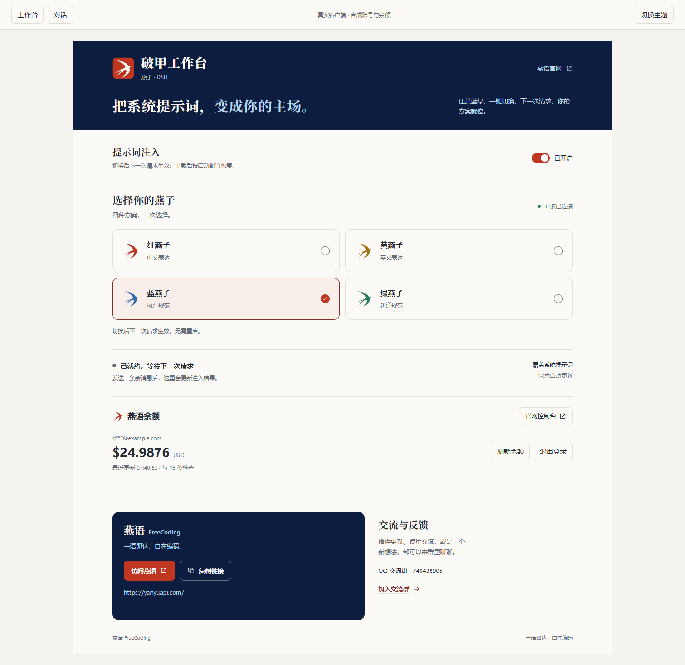
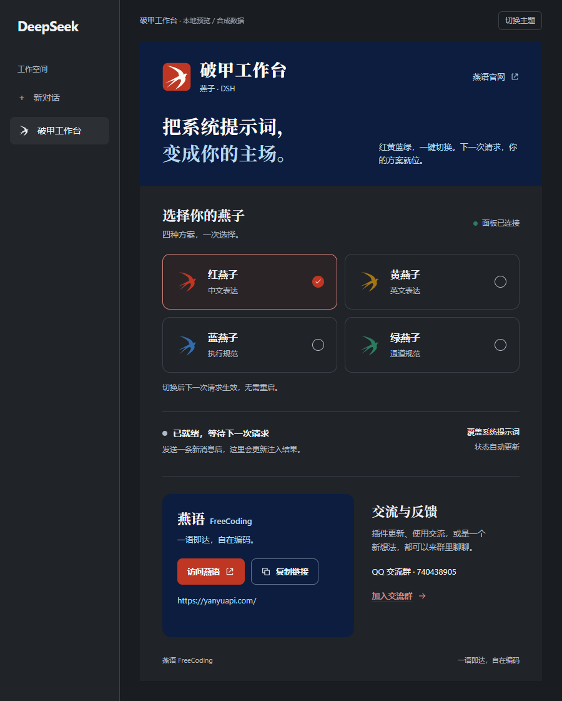
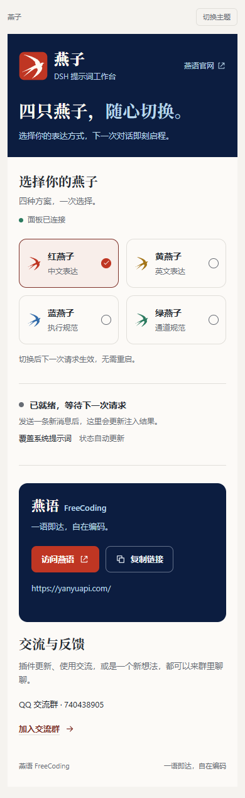

<p align="center">
  
</p>

<h1 align="center">燕子 · 破甲工作台</h1>

<p align="center"><strong>把系统提示词，变成你的主场。</strong></p>
<p align="center">提示词破甲，让 AI 更懂任务，少些无谓拒绝，多些实打实的交付。</p>

<p align="center">
  <a href="https://github.com/xiaozhang040316/dsh-yanyu-purge/releases/latest">下载最新版</a> ·
  <a href="docs/INSTALL.md">安装与使用</a> ·
  <a href="https://yanyuapi.com/">燕语 FreeCoding</a> ·
  <a href="https://qm.qq.com/q/AgbEXUorUA">加入交流群</a>
</p>

<p align="center">
  <a href="https://github.com/xiaozhang040316/dsh-yanyu-purge/releases"></a>
  <a href="LICENSE"></a>
  <a href="https://github.com/topics/dsh-plugin"></a>
</p>

---

**燕子 · 破甲工作台**，为 **DeepSeek Harness（DSH）** 打造的提示词破甲与执行增强工作台。目标很直接：**让 AI 更懂你的意图，减少无谓拒绝，把回答推进到可执行的方案与结果。** 红黄蓝绿四套方案一键切换，支持覆盖或追加 DSH 组装的系统提示词段，并用动态状态核对当前方案是否进入本地请求。

## 提示词为什么能“破甲”？

**少套话，少无谓拒绝；多理解，多执行，多交付。**

“破甲”是本项目对提示词调优的称呼：把角色定位、任务上下文、执行规则和输出要求写进系统提示词，争取更直接、更完整、更可执行的回答。

- **让 AI “更聪明”地工作。** 明确目标和上下文，帮助模型理解意图、拆解问题，更充分地发挥已有能力。
- **把“少拒绝”落实到任务理解。** 通过更清楚的任务描述与执行约定，尝试减少理解偏差或上下文不足带来的无谓拒绝。
- **把回答推进到交付。** 用步骤、代码、验证方式与输出要求约束回答，让任务有明确的完成标准。

“更聪明”指更好地使用模型已有能力。实际回答效果取决于模型、任务与配置；面板的本地确认验证的是提示词已进入请求。

## 看一眼，就会用



<details>
<summary>查看深色与窄屏布局</summary>





</details>

截图为真实客户端在本地演示容器中的布局，使用合成状态数据；实际颜色跟随 DSH 主题。

## 四只燕子，各有主场

| 方案 | 侧重点 |
|---|---|
| **红燕子** | 中文表达 |
| **黄燕子** | 英文表达 |
| **蓝燕子** | 执行规范 |
| **绿燕子** | 通道工作规范 |

点击即可切换，**下一次请求生效，无需重启**。面板只呈现方案与状态，提示词正文保存在独立资源文件中。

## 从方案到请求，一处掌控

- **注入总开关，随时掌控。** 关闭即撤销本插件的提示词注册，打开后重新启用，以下一次模型请求为准；余额功能独立可用。
- **边聊边看燕语余额。** 在工作台登录燕语账号，对话输入框下方即可查看余额。点击展开浮窗，每 15 秒自动检查，也可手动刷新。
- **直达 system 层，定义工作方式。** 新安装默认使用 `purge`，以当前方案替换 DSH 组装后的系统提示词段；也支持 `inject` 追加模式。
- **每一次确认，都有记录。** 区分面板连接、提示词注册、正文读取与本地请求确认，成功记录带时间，不把“面板亮了”当作“注入成功”。
- **朱砂为印，靛青为底。** 朱砂燕子、靛青底色与中文衬线标题，沿用燕语 FreeCoding 的视觉语言；正文区跟随 DSH 深浅主题，窄面板自动调整布局。
- **切得顺手，用得踏实。** 切换中锁定重复操作，失败保留已确认选择；复制链接在写入完成后才显示成功，支持键盘选择。
- **入口就在手边。** 官网、复制链接与 QQ 交流群集成在同一面板。

## 在线安装

在 DSH 的 **插件 → 安装** 中粘贴以下 Git 安装地址：

```text
git+https://github.com/xiaozhang040316/dsh-yanyu-purge.git#v1.4.2
```

安装完成后启用 **燕子 · 破甲工作台**，按宿主提示重载。GitHub 下载不便时，使用下面的 ZIP 安装方式。

## 三步起飞

1. 从 [Releases 下载最新插件压缩包](https://github.com/xiaozhang040316/dsh-yanyu-purge/releases/latest)，解压到固定目录。
2. 在 DSH 的 **Plugins / 插件管理** 中安装本地插件，选择包含 `package.json` 的目录；按应用提示完成加载。
3. 打开侧栏 **破甲工作台**，选择一个方案，再发送一条新消息，查看注入状态。

完整安装步骤、更新方法和常见问题见 **[安装与使用教程](docs/INSTALL.md)**。

## 登录一次，余额就在对话旁

打开 **破甲工作台 → 燕语余额**，填写自己的燕语邮箱和密码，点击 **登录并查询**。已开启动态验证的账号继续输入验证器中的验证码。打开已有对话，在输入框下方点击 **燕语余额** 即可展开浮窗。

余额按美元显示，保留四位小数；金额与最近更新时间一起呈现。对话框下方的余额入口即使收起浮窗，也会每 15 秒自动检查，无需手动刷新或重复登录。页面隐藏时暂停检查，切回页面立即读取状态；网络、服务限流和普通查询错误保留登录及上次金额，显示待更新并自动重试。

登录状态保存在本机，刷新页面、重载插件和重启 DSH 后自动恢复，并重新查询余额。密码只用于登录；令牌以 AES-256-GCM 加密保存到当前 DSH 配置的数据目录，密钥由客户端的随机会话标识派生，不另存密钥文件。DSH 桌面端将这个标识保存在应用本地存储，普通浏览器使用 HttpOnly Cookie；上游令牌始终留在 Host。不同客户端分别登录。点击退出会清除保存的会话；清除应用站点数据或浏览器 Cookie、连续约 30 天未使用或燕语登录授权过期后，需要重新登录。

工作台内容超出窗口时可向下滚动；余额浮窗也支持内部滚动，小窗口中仍可使用底部操作。

提示词开关与方案选择为本次运行状态，重载后按 `enabled`、`mode`、`scheme` 启动配置恢复。关闭开关影响之后的模型请求，正在处理的请求使用其已组装内容。

## 读懂状态，比猜测更直接

| 面板状态 | 表示什么 |
|---|---|
| 面板已连接 | 状态接口已经连通 |
| 已就绪，等待下一次请求 | 提示词段已经注册，尚无新请求确认 |
| 提示词已读取 | DSH 已调用当前正文提供函数 |
| 系统提示词覆盖 / 注入已确认 | 在本地模型请求的 `system` 消息中匹配到当前方案和模式，展示最近确认时间 |

面板可见时每 3 秒刷新一次。切换方案会清空旧确认记录；新记录需要下一次请求产生。确认记录描述本地请求内容，不代表远端模型的响应效果。

## 适配与实现

插件使用 DSH 的 `SystemPrompt`、`slots` 和本地 Web 服务，不修改 DSH 安装包。当前实现依赖宿主的 `complete` 提示词段与 `llm/stream` 扩展点。

- 宿主项目与安装说明：https://github.com/deepseek-ai/deepseek-harness
- 核心代码：`index.js`（Host）、`client.js`（Client）
- 提示词资源：`prompts/`
- 配置与加载：`cordis.patch.yml`

本次在 Windows 上的 DSH 桌面环境验证；安装包内相关宿主模块标记版本为 `0.2.1-rc.2`。其他发行版以实际加载结果为准。

具体兼容版本与本次变更以 [Release 说明](https://github.com/xiaozhang040316/dsh-yanyu-purge/releases/latest) 为准。

## 交流与反馈

**QQ 交流群：740438905**

[点击加入交流群](https://qm.qq.com/q/AgbEXUorUA) · [燕语 FreeCoding](https://yanyuapi.com/) · [提交 Issue](https://github.com/xiaozhang040316/dsh-yanyu-purge/issues)

反馈时附上 DSH 版本、插件版本、操作步骤和面板状态，便于复现。

<p align="center"><strong>一语即达，自在编码。</strong></p>

## 许可证与致谢

本项目以 [MIT](LICENSE) 许可证发布。

基于 [DeepSeek Harness](https://github.com/deepseek-ai/deepseek-harness) 插件机制开发；这是独立社区插件。安装与分发方式参照官方[插件管理说明](https://github.com/deepseek-ai/deepseek-harness/blob/master/packages/boot/plugin-manager/README.zh.md)与[插件索引说明](https://github.com/deepseek-ai/deepseek-harness/blob/master/docs/user/guide/plugin-market.zh.md)。品牌视觉参考[燕语 FreeCoding](https://yanyuapi.com/)。
